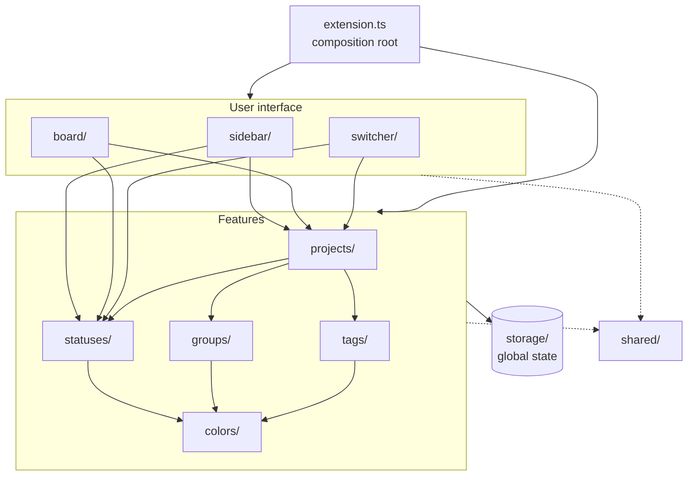
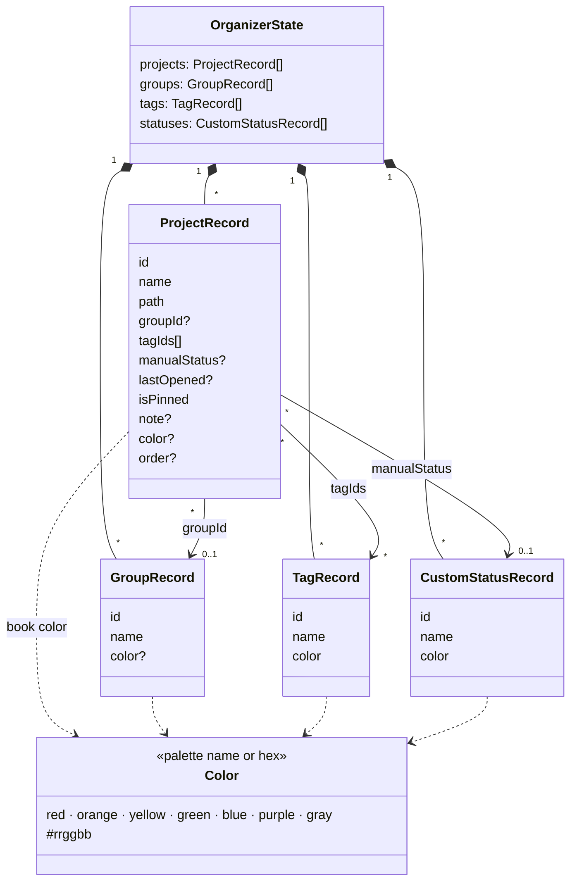
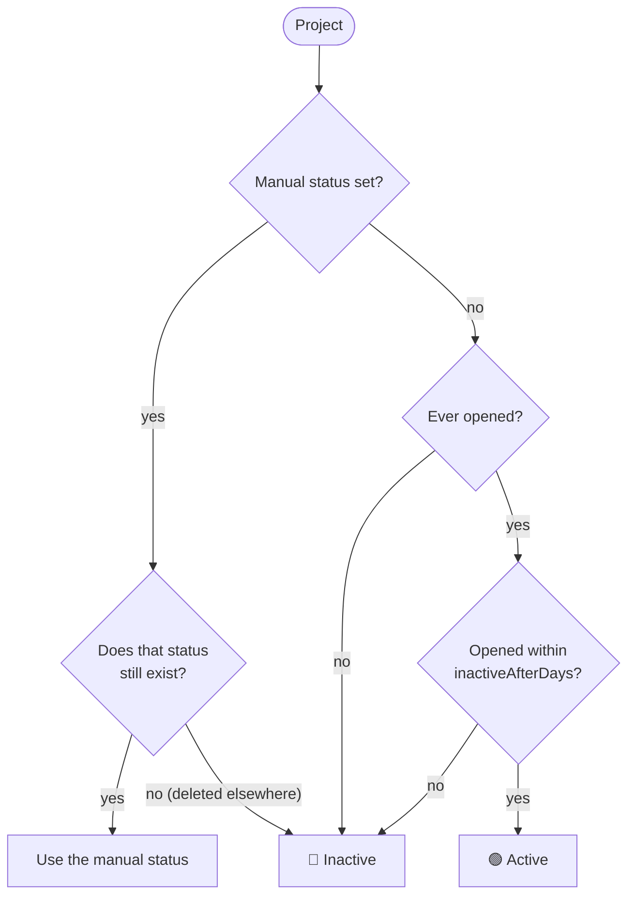
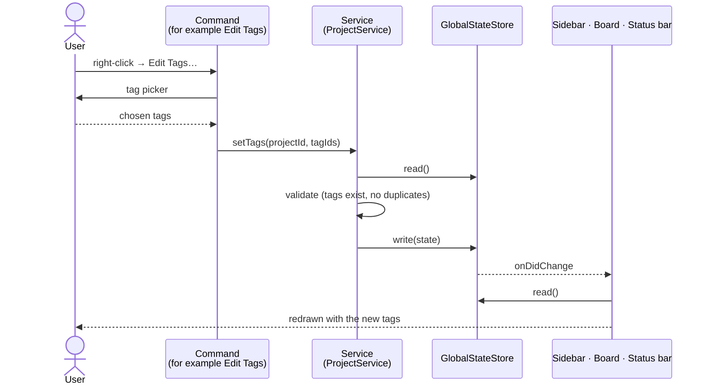
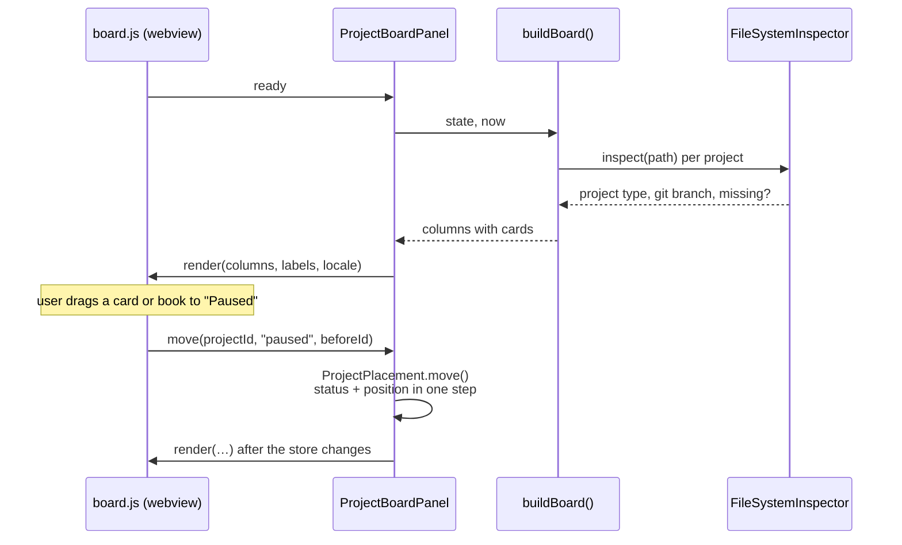
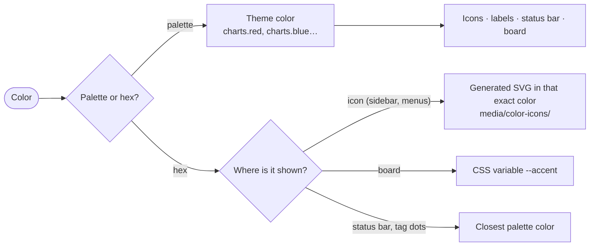

# Architecture

How Projects Hub is put together. Start here before changing the code.

- [Folders](#folders)
- [How the features depend on each other](#how-the-features-depend-on-each-other)
- [Data model](#data-model)
- [How a status is decided](#how-a-status-is-decided)
- [What happens when something changes](#what-happens-when-something-changes)
- [The project board](#the-project-board)
- [How a color is shown](#how-a-color-is-shown)
- [Build and test](#build-and-test)

---

## Folders

The code is organized **per feature**, not per technical type.

| Folder | Responsibility |
|---|---|
| `src/extension.ts` | Entry point and composition root: creates every part once and wires them together. |
| `storage/` | The saved model (`OrganizerState`), the `StateStore` abstraction and `GlobalStateStore` (VS Code global state + Settings Sync). |
| `projects/` | Saving and opening projects, notes, assigning status, group and tags. |
| `statuses/` | Built-in and custom statuses, `StatusResolver` (automatic or manual), status picker and management. |
| `groups/` | Virtual groups with a color. Never touches folders on disk. |
| `tags/` | Colored tags and the tag picker. |
| `colors/` | Color model (palette or hex), color picker, generated SVG icons, recent colors. |
| `sidebar/` | The tree view: layouts per group, tag or status, items, tooltips, drag and drop. |
| `board/` | The project board webview: board model, folder inspection (project type, git branch), panel. |
| `switcher/` | Quick switcher (`Ctrl+Alt+P`) and the status bar item. |
| `shared/` | Small helpers used by several features: errors, name validation, path comparison, settings. |
| `media/` | Webview pages (`board.*`, `color-picker.*`) and icons. |

**Domain logic does not import `vscode`.** Services, `StatusCatalog`, `StatusResolver`, the sidebar layouts, `BoardModel` and the color model are plain TypeScript and are unit tested with mocha.

---

## How the features depend on each other

Arrows point from a feature to what it uses. There are no cycles between features. Every feature saves through `storage/`.

---

## Data model

Everything is saved as one `OrganizerState` object under the key `projectsHub.state`. That key is registered for Settings Sync.

Rules that keep the data consistent:

- Deleting a **group** makes its projects ungrouped.
- Deleting a **tag** removes it from every project.
- Deleting a **custom status** puts its projects back on automatic.
- Names of groups, tags and statuses are unique, ignoring case. Custom statuses may not reuse a built-in name.

---

## How a status is decided

`StatusResolver` turns a project into one status definition.

Paused and Archived are never automatic. Only the user sets them.

---

## What happens when something changes

Every change goes through a service, which validates it and writes the whole state in one step. The store then tells every view to redraw.

A rule violation, such as a duplicate name, throws a `DomainError`. `registerSafeCommand` shows it as a warning instead of failing silently.

Global state is not pushed between open windows, so every window also re-reads it when it gets focus.

---

## The project board

The board is a webview with two views on the same data: **Board** (kanban columns) and **Shelf** (a bookcase). Both get one column or shelf per status; the order inside it comes from `compareForShelf` (dragged order first, then pinned, then by name).

The board is a webview. The extension builds the full board model and sends it to the page. The page sends back what the user did.

- The page scripts are split by job: `board-common.js` (helpers, drag and drop), `board-columns.js`, `board-shelf.js` and `board.js` (view switch and search).
- The page only uses `textContent` for user text, never `innerHTML`.
- A strict Content Security Policy only allows the bundled script and stylesheet.
- All labels are translated by the extension and sent with the render message, because the page itself has no access to `vscode.l10n`.

---

## How a color is shown

A `Color` is either a **palette** name, which follows the theme, or a fixed **hex** value. VS Code accepts arbitrary colors only in some places.

Generated SVG icons are written inside the extension folder, because the tree view does not load icons from other places such as `globalStorage`.

---

## Build and test

| Task | Command |
|---|---|
| Install dependencies | `npm install` |
| Compile | `npm run compile` (or `npm run watch`) |
| Unit tests | `npm test` |
| Smoke test in a real VS Code | `npm run test:integration` |
| Run the extension | `F5` → *Run Extension* |
| Build a package | `npx vsce package` |

The smoke test starts a real VS Code. Set `VSCODE_EXECUTABLE` to an installed `Code.exe` to avoid downloading one. VS Code splits launch paths on spaces on Windows, so on such a path run it from a junction without spaces.

### Releasing

1. Bump `version` in `package.json` and add the changes to `CHANGELOG.md`.
2. `npx vsce package`.
3. Upload the `.vsix` at [marketplace.visualstudio.com/manage](https://marketplace.visualstudio.com/manage) → the extension → **Update**.

Command, setting and storage ids (`projectsHub.*`) are public now. Do not rename them without a migration.
